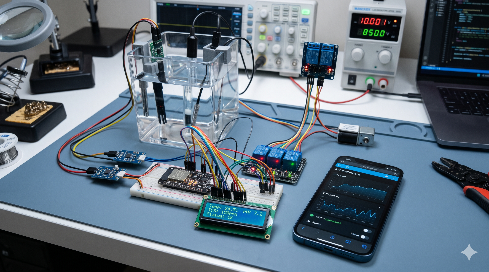

# HDKP AI Smart Aqua Monitor (ESP32)

**Ngôn ngữ:** [English](README.md) | Tiếng Việt

**Hệ thống giám sát và điều khiển chất lượng nước bể thủy sinh sử dụng ESP32**

<p align="center">
  
</p>


Phiên bản: **v1.8.6**

HDKP AI Smart Aqua Monitor là dự án firmware ESP32 phục vụ giám sát và điều khiển chất lượng nước bể thủy sinh. Hệ thống hỗ trợ đo pH, TDS, nhiệt độ; tự động điều khiển bơm và relay; hiển thị thông tin trên LCD và giao diện web; truyền dữ liệu qua MQTT/ThingSpeak; đồng thời hỗ trợ chatbot AI và tích hợp MCP với XiaoZhi.

> **English summary:** ESP32-based aquarium and water-quality monitoring and control firmware featuring pH, TDS and temperature monitoring, automatic pump/relay control, LCD, web dashboard, MQTT/ThingSpeak telemetry, optional AI chatbot backend and MCP integration with XiaoZhi. Version 1.8.4 includes security and reliability improvements. See [CHANGELOG.md](CHANGELOG.md).

---

## Mục lục

- [Tính năng](#tính-năng)
- [Phần cứng và sơ đồ chân](#phần-cứng-và-sơ-đồ-chân)
- [Thư viện cần cài đặt](#thư-viện-cần-cài-đặt)
- [Cài đặt nhanh](#cài-đặt-nhanh)
- [Cấu hình secrets.h](#cấu-hình-secretsh)
- [Điều khiển bơm và relay](#điều-khiển-bơm-và-relay)
- [Lệnh Serial](#lệnh-serial)
- [API Web](#api-web)
- [MQTT](#mqtt)
- [Bảo mật](#bảo-mật)
- [Giới hạn đã biết](#giới-hạn-đã-biết)
- [Cấu trúc dự án](#cấu-trúc-dự-án)
- [Xử lý sự cố](#xử-lý-sự-cố)
- [Đóng góp](#đóng-góp)
- [Giấy phép](#giấy-phép)

---

## Tính năng

### 1. Giám sát chất lượng nước

- Đo pH, hỗ trợ lọc trung vị và lọc thông thấp.
- Đo TDS, hỗ trợ bù nhiệt theo cấu hình firmware.
- Đo nhiệt độ bằng cảm biến DS18B20, hỗ trợ tối đa 3 cảm biến.
- Theo dõi xu hướng pH/TDS và đánh giá mức rủi ro bằng thuật toán phân tích nhẹ trên ESP32.
- Hiển thị dữ liệu và cảnh báo trên LCD 16x2.
- Sử dụng LED để báo trạng thái và cảnh báo chất lượng nước.

### 2. Điều khiển tự động

- Điều khiển bơm theo ngưỡng pH.
- Điều khiển relay theo nhiệt độ cảm biến tương ứng.
- Có chế độ Auto và Manual.
- Hỗ trợ ngưỡng điều khiển và độ trễ nhằm hạn chế relay đóng/ngắt liên tục.
- Có cơ chế giới hạn thời gian chạy bơm trong chế độ Auto theo cấu hình firmware.

**Lưu ý:** Các cơ chế bảo vệ bằng phần mềm không thay thế thiết bị bảo vệ điện hoặc cơ chế ngắt khẩn cấp độc lập.

### 3. Giao diện Web

- Dashboard hiển thị dữ liệu cảm biến và trạng thái thiết bị.
- Đăng nhập bằng tài khoản và mật khẩu.
- Điều khiển bơm/relay và chuyển chế độ vận hành.
- Cấu hình ngưỡng pH, TDS và nhiệt độ.
- Quản lý nhật ký bảo trì.
- Hỗ trợ giao diện tiếng Việt và tiếng Anh.
- Chatbot hỗ trợ lệnh tiếng Việt và hỏi đáp thông qua máy chủ AI tùy chọn.

### 4. Kết nối và tích hợp

- Wi-Fi và captive portal cấu hình mạng.
- MQTT để truyền dữ liệu và cảnh báo.
- ThingSpeak để ghi nhận dữ liệu từ xa.
- OTA để cập nhật firmware qua mạng theo cấu hình.
- MCP tools tích hợp với XiaoZhi.
- Máy chủ AI FastAPI tùy chọn để xử lý chatbot và nhật ký.

---

## Phần cứng và sơ đồ chân

Bảng dưới đây mô tả cấu hình chân theo tài liệu dự án. Hãy đối chiếu với firmware và bo mạch thực tế trước khi đấu nối.

| Chức năng | Chân ESP32 | Ghi chú |
|---|---|---|
| DS18B20 (OneWire) | GPIO 4 | Điện trở kéo lên thường dùng 4.7 kΩ |
| Cảm biến TDS | GPIO 36 (ADC1) | Kiểm tra điện áp đầu ra của module |
| Cảm biến pH | GPIO 34 (ADC1) | Firmware có thể áp dụng hệ số điện áp ×1.5; cần xác minh và hiệu chuẩn theo mạch thực tế |
| Relay bơm | GPIO 5 | Active-LOW; GPIO 5 là chân strapping trên ESP32 cổ điển |
| Relay 0 / 1 / 2 | GPIO 32 / 33 / 25 | Theo cấu hình firmware |
| LED cảnh báo TDS / nhiệt | GPIO 2 / 26 | GPIO 2 có thể ảnh hưởng quá trình khởi động trên một số bo mạch |
| LED khác | GPIO 27 / 14 | Xác minh cách sử dụng trong firmware |
| LCD 16x2 I²C | SDA 21 / SCL 22 | Địa chỉ thường dùng: `0x27` |

### Lưu ý về phần cứng

- ESP32 sử dụng mức logic 3.3 V. Không đưa điện áp vượt giới hạn cho phép vào GPIO hoặc ADC.
- Kiểm tra điện áp đầu ra của module pH/TDS trước khi nối với ESP32.
- Cảm biến pH cần hiệu chuẩn bằng dung dịch chuẩn phù hợp.
- TDS cần được hiệu chuẩn theo cảm biến và dung dịch chuẩn thực tế.
- Kiểm tra mức kích hoạt của relay: Active-LOW và Active-HIGH không giống nhau.
- GPIO 5 và GPIO 2 có chức năng liên quan đến cấu hình khởi động trên một số dòng ESP32. Cần kiểm tra mạch relay/LED để tránh ảnh hưởng boot.
- Đảm bảo nguồn cấp, cách điện, cầu chì và relay phù hợp với tải thực tế.

### Lưu ý về ánh xạ relay

Theo mô tả hiện tại, relay nhiệt độ có thể được điều khiển tự động theo cảm biến tương ứng, trong khi giao diện web/chatbot có thể đặt tên một số relay là “Đèn” hoặc “Oxy”.

Nếu đấu đèn hoặc máy sủi vào relay đang được điều khiển tự động theo nhiệt độ, thiết bị có thể bật/tắt ngoài mong muốn. Hãy kiểm tra ánh xạ relay trong code, giao diện và cấu hình thực tế trước khi vận hành.

---

## Thư viện cần cài đặt

Cài đặt các thư viện tương ứng qua Arduino IDE Library Manager hoặc nguồn chính thức của từng dự án:

- **ESP32 Arduino Core:** Wi-Fi, WebServer, Preferences, HTTPClient, ArduinoOTA và các thành phần liên quan.
- `OneWire`
- `DallasTemperature`
- `ArduinoJson` — phiên bản tương thích với firmware; dự án có định hướng hỗ trợ nhánh 6.x và 7.x.
- `PubSubClient`
- `LiquidCrystal_I2C`
- `WebSocketMCP` — thư viện MCP dùng trong tích hợp XiaoZhi.

Phiên bản thư viện có thể ảnh hưởng đến khả năng biên dịch. Nên ghi nhận phiên bản đã kiểm thử trong môi trường phát hành chính thức.

Các thư viện bên thứ ba có thể sử dụng giấy phép riêng. Xem mục [Giấy phép](#giấy-phép).

---

## Cài đặt nhanh

### Bước 1: Chuẩn bị môi trường

1. Cài Arduino IDE.
2. Cài ESP32 Arduino Core tương thích với dự án.
3. Tải hoặc clone repository về máy tính.
4. Cài đặt các thư viện cần thiết.

### Bước 2: Mở firmware

Mở file:

`WaterControlESP32v1.8.6.ino`

Tên thư mục chứa sketch nên trùng với tên file `.ino` theo quy ước Arduino IDE.

### Bước 3: Tạo cấu hình riêng tư

1. Sao chép `secrets.example.h` thành `secrets.h`.
2. Cấu hình các thông số cần thiết.
3. Không đưa `secrets.h` chứa thông tin thật lên GitHub.
4. Kiểm tra `.gitignore` để bảo đảm tệp cấu hình riêng tư được loại khỏi commit.

### Bước 4: Chọn bo mạch và nạp firmware

1. Chọn đúng loại board ESP32.
2. Chọn cổng COM.
3. Kiểm tra chân GPIO và nguồn cấp.
4. Biên dịch firmware.
5. Nạp firmware và mở Serial Monitor ở tốc độ 115200 baud.

### Bước 5: Cấu hình Wi-Fi

Trong lần khởi động đầu tiên, nếu firmware chưa có cấu hình Wi-Fi, thiết bị có thể mở Access Point để người dùng kết nối và nhập thông tin mạng.

Theo cấu hình được mô tả cho dự án:

- SSID AP: `ESP32-HD7-Ver1.1`.
- Mật khẩu AP có thể được sinh tự động.
- Thông tin cấu hình có thể được lưu trong NVS.
- Sau khi kết nối Wi-Fi, địa chỉ IP của ESP32 có thể được dùng để truy cập dashboard.

Hãy lấy SSID, mật khẩu và địa chỉ IP thực tế từ LCD, Serial Monitor hoặc bộ định tuyến. Không giả định mật khẩu hay IP sẽ giống nhau trên mọi thiết bị.

### Bước 6: Đăng nhập và đổi mật khẩu

Nếu firmware tạo mật khẩu web ngẫu nhiên, lấy thông tin đăng nhập từ kênh quản trị được firmware quy định. Đổi mật khẩu mặc định hoặc mật khẩu tạm ngay sau lần đăng nhập đầu tiên.

Không mở trực tiếp cổng HTTP của ESP32 ra Internet.

### Bước 7: Cấu hình các dịch vụ tùy chọn

- ThingSpeak: nhập Write API Key nếu sử dụng.
- MQTT: cấu hình broker và thông tin xác thực.
- MCP: cấu hình token theo yêu cầu của máy chủ.
- AI chatbot: cấu hình địa chỉ máy chủ FastAPI nếu cần.

---

## Cấu hình `secrets.h`

Các thông số dưới đây phản ánh cấu hình được mô tả cho dự án. Hãy xác minh tên macro và giá trị mặc định trong `secrets.example.h` của đúng phiên bản firmware.

| Macro | Giá trị mặc định được mô tả | Ý nghĩa |
|---|---|---|
| `MQTT_HOST` | `broker.emqx.io` | Địa chỉ broker MQTT |
| `MQTT_PORT` | `8883` | Cổng MQTT TLS thường dùng |
| `MQTT_USER` / `MQTT_PASS` | Rỗng | Thông tin xác thực broker |
| `MQTT_DEVICE_ID` | `aqua_<MAC>` | Định danh thiết bị trong topic |
| `MQTT_CA_CERT` | Không có | Chứng chỉ CA dùng xác thực máy chủ TLS |
| `MQTT_REMOTE_CONTROL` | `0` | `1` để cho phép điều khiển bơm từ xa qua MQTT nếu firmware hỗ trợ |
| `OTA_PASSWORD` | Rỗng | Mật khẩu OTA; theo mô tả cần ít nhất 8 ký tự |
| `AI_SERVER_URL` | Rỗng | URL máy chủ FastAPI, ví dụ `http://192.168.1.90:8000` |
| `AI_USER_ID` | `web_user` | ID gửi kèm yêu cầu chatbot |
| `AP_PASSWORD` | Tự sinh | Có thể đặt mật khẩu AP cố định nếu firmware hỗ trợ |

### Khuyến nghị bảo mật cấu hình

- Không sử dụng broker công khai để điều khiển thiết bị thực tế nếu chưa có xác thực và giới hạn quyền phù hợp.
- Không chia sẻ Wi-Fi password, MCP token, ThingSpeak key hoặc OTA password.
- Không đưa các khóa bí mật vào mã nguồn công khai, ảnh chụp màn hình hoặc log phát hành.
- Nếu một khóa đã bị công bố, hãy thu hồi và tạo khóa mới.
- Không coi việc lưu khóa trong `secrets.h` là biện pháp bảo vệ khi firmware đã được nạp vào thiết bị.

---

## Điều khiển bơm và relay

### Điều khiển bơm theo pH

Theo mô tả hiện tại:

- Auto bật bơm khi pH vượt ngưỡng cấu hình.
- Auto tắt bơm khi pH xuống dưới ngưỡng trừ đi độ trễ 0.5.
- Khi cảm biến gặp lỗi, firmware được mô tả là tắt bơm.
- Thời gian chạy tối đa trong Auto: 30 phút.
- Thời gian nghỉ sau chu kỳ chạy: 10 phút.
- Chế độ Manual có thể không áp dụng giới hạn thời gian chạy như Auto.

Hãy xác minh các hành vi trên trong mã nguồn và thử nghiệm trên thiết bị trước khi sử dụng thực tế. Không dựa vào điều khiển pH đơn độc để bảo đảm an toàn cho sinh vật trong bể.

### Điều khiển relay nhiệt độ

Relay có thể được cấu hình theo cảm biến nhiệt độ tương ứng. Ngưỡng bật/tắt, chiều điều khiển và độ trễ phụ thuộc vào firmware và cấu hình.

Trước khi nối thiết bị sưởi, đèn, máy sủi hoặc tải điện khác, cần kiểm tra chính xác điều kiện đóng/ngắt relay.

---

## Lệnh Serial

Serial Monitor sử dụng tốc độ 115200 baud theo hướng dẫn dự án.

Các lệnh được mô tả:

| Lệnh | Mục đích |
|---|---|
| `HELP` | Hiển thị trợ giúp |
| `CALTDS` | Hiệu chuẩn TDS |
| `CALTEMP S0 MIN <giá trị>` | Cấu hình ngưỡng MIN cho cảm biến S0 nếu firmware hỗ trợ cú pháp này |
| `CALTEMP S0 MAX <giá trị>` | Cấu hình ngưỡng MAX cho cảm biến S0 nếu firmware hỗ trợ cú pháp này |
| `SETKEY <ThingSpeakKey>` | Cấu hình khóa ThingSpeak |
| `SETMCP <token>` | Cấu hình MCP token |
| `SETNUMTEMP <1..3>` | Cấu hình số cảm biến nhiệt độ |
| `SAVE` | Lưu cấu hình đang chỉnh sửa |
| `CANCEL` | Hủy thay đổi nếu firmware hỗ trợ |
| `RESET` | Đặt lại cấu hình theo hành vi được firmware triển khai |

Cú pháp chính xác và các biến thể lệnh cần được đối chiếu với mã xử lý Serial trong phiên bản đang sử dụng.

**Cảnh báo:** Lệnh `RESET` có thể xóa cấu hình và thông tin xác thực. Chỉ sử dụng khi đã hiểu rõ hành vi và sẵn sàng cấu hình lại thiết bị.

---

## API Web

Các endpoint dưới đây được ghi nhận theo mô tả của dự án. Hãy xác minh phương thức, schema và quyền truy cập trong mã nguồn trước khi tích hợp với hệ thống bên ngoài.

| Phương thức | Đường dẫn | Mục đích |
|---|---|---|
| `GET` | `/` | Dashboard |
| `GET` | `/api/data` | Dữ liệu cảm biến và trạng thái hiện tại |
| `POST` | `/api/control/relay` | Điều khiển relay |
| `POST` | `/api/control/mode` | Chuyển chế độ Auto/Manual |
| `POST` | `/api/settings/ph_threshold` | Cấu hình ngưỡng pH |
| `GET` / `POST` | `/api/sysconfig` | Đọc hoặc cập nhật cấu hình hệ thống |
| `POST` | `/api/sysconfig/reset` | Đặt lại cấu hình |
| `POST` | `/api/settings/credentials` | Đổi thông tin đăng nhập |
| `POST` | `/api/ai/chat` | Chatbot và lệnh tiếng Việt |
| `GET` / `POST` | `/api/maintenance` | Đọc hoặc cập nhật nhật ký bảo trì |

Ví dụ payload điều khiển relay theo mô tả:

```json
{
  "relay": 0,
  "status": true
}
```

Ví dụ payload chuyển chế độ:

```json
{
  "mode": "auto"
}
```

Các ví dụ trên chỉ minh họa cấu trúc. Hãy kiểm tra ánh xạ relay, kiểu dữ liệu, dải giá trị và xác thực yêu cầu trong firmware thực tế.

Nếu API sử dụng HTTP Basic Authentication qua HTTP thường, thông tin đăng nhập và nội dung yêu cầu không được mã hóa trên đường truyền.

---

## MQTT

Theo mô tả của dự án, topic có dạng:

`watermonitor/<deviceId>/...`

Các topic dự kiến gồm:

| Topic | Nội dung |
|---|---|
| `status` | Trạng thái online/offline và Last Will nếu được cấu hình |
| `data` | Dữ liệu cảm biến và thông tin phân tích |
| `alert` | Cảnh báo |
| `config/state` | Trạng thái cấu hình không chứa khóa bí mật |
| `telemetry` | Dữ liệu giám sát |
| `control/pump` | Lệnh `ON` / `OFF` nếu bật điều khiển từ xa |

Cần đối chiếu topic đầy đủ, QoS, retained message và schema JSON trong mã nguồn.

### Lưu ý MQTT TLS

Cổng 8883 thường được dùng cho MQTT qua TLS, nhưng chỉ dùng cổng này không có nghĩa là kết nối đã được xác thực an toàn.

- Cấu hình chứng chỉ CA phù hợp khi firmware hỗ trợ.
- Kiểm tra firmware có xác minh chứng chỉ máy chủ hay không.
- Không bật chế độ bỏ qua xác minh chứng chỉ trong môi trường không tin cậy.
- Sử dụng broker có tài khoản, mật khẩu và ACL giới hạn quyền.
- Không dùng broker công khai để điều khiển tải điện thực tế nếu không có biện pháp bảo vệ thích hợp.
- Chỉ bật `MQTT_REMOTE_CONTROL` khi đã đánh giá xác thực, phân quyền và các điều kiện an toàn của hệ thống.

---

## Bảo mật

### 1. Web dashboard

Nếu dashboard sử dụng HTTP Basic Authentication qua HTTP thường:

- Thông tin xác thực không được mã hóa trên đường truyền.
- Chỉ nên truy cập trong mạng LAN đáng tin cậy.
- Không mở trực tiếp cổng HTTP của ESP32 ra Internet.
- Nếu cần truy cập từ xa, hãy sử dụng VPN hoặc reverse proxy HTTPS được cấu hình đúng cách.
- Kiểm tra bảo vệ CSRF đối với các API thay đổi trạng thái thiết bị.

### 2. Lưu trữ thông tin xác thực

Nếu firmware lưu mật khẩu hoặc khóa trong flash/NVS dưới dạng văn bản, người có quyền truy cập vật lý hoặc khả năng trích xuất flash có thể có nguy cơ lấy được thông tin đó.

- Không coi NVS là vùng lưu trữ bí mật tuyệt đối.
- Đánh giá khả năng bật flash encryption và các tính năng bảo vệ phù hợp với bo mạch.
- Không chia sẻ firmware, log hoặc bản sao cấu hình có chứa khóa thật.

### 3. ThingSpeak và dịch vụ bên ngoài

Nếu phiên bản firmware gửi ThingSpeak qua HTTP thường, API key có thể bị lộ trên đường truyền. Ưu tiên HTTPS khi endpoint và thư viện hỗ trợ, đồng thời xác minh chứng chỉ máy chủ.

### 4. OTA

- Đặt mật khẩu OTA đủ mạnh.
- Chỉ cho phép cập nhật từ mạng đáng tin cậy.
- Không mở dịch vụ OTA trực tiếp ra Internet.
- Kiểm tra tính toàn vẹn và nguồn gốc firmware trước khi triển khai.
- Không coi mật khẩu OTA là biện pháp thay thế cho bảo vệ mạng.

### 5. Khóa từng được công bố

Nếu các phiên bản cũ đã làm lộ ThingSpeak Write Key, MCP token hoặc thông tin xác thực khác, hãy thu hồi và tạo khóa mới. Không chỉ xóa khóa khỏi phiên bản mới vì dữ liệu đã công bố có thể vẫn tồn tại trong lịch sử Git hoặc log.

### 6. Báo cáo lỗ hổng

Nếu phát hiện lỗ hổng bảo mật, hãy sử dụng GitHub Security Advisories nếu repository hỗ trợ hoặc liên hệ riêng với người duy trì dự án. Tránh đăng công khai khóa bí mật, thông tin truy cập hoặc chi tiết có thể gây rủi ro trước khi có biện pháp khắc phục.

---

## Giới hạn đã biết

- Máy chủ AI FastAPI cho chatbot và nhật ký không nằm trong repository firmware này, trừ khi được bổ sung ở phiên bản khác.
- Nếu chưa cấu hình `AI_SERVER_URL`, các chức năng cần máy chủ AI có thể không hoạt động; những lệnh điều khiển nội bộ có thể vẫn khả dụng tùy cách triển khai.
- Dashboard sử dụng Chart.js và Font Awesome từ CDN theo mô tả hiện tại; giao diện tương ứng cần Internet để tải các tài nguyên đó.
- Hiệu chuẩn pH/TDS phụ thuộc cảm biến, module analog và điều kiện đo thực tế.
- Tính chính xác của dự đoán và phân tích AI nhẹ phụ thuộc dữ liệu và thuật toán; không thay thế thiết bị đo chuyên dụng.
- Tính năng bảo mật thực tế phụ thuộc cấu hình firmware, thư viện và môi trường triển khai.
- Cần thử nghiệm với tải giả trước khi nối tải điện thực tế.
- Không sử dụng hệ thống làm thiết bị bảo vệ an toàn duy nhất cho bơm, bộ sưởi hoặc sinh vật trong bể.

---

## Cấu trúc dự án

Cấu trúc minh họa theo tài liệu dự án:

```text
WaterControlESP32v1.8.6/
├── WaterControlESP32v1.8.6.ino
├── SharedConfig.h
├── WaterQualityMonitorLib.h
├── WebServerManager.h
├── WiFiPortal.h
├── MQTTManager.h
├── MCPService.h
├── OTAUpdate.h
├── LCD.h
├── ConfigManager.h
├── secrets.example.h
├── README.md
├── CHANGELOG.md
└── LICENSE
```

Tên tệp và cấu trúc thư mục thực tế có thể khác tùy phiên bản. Hãy cập nhật sơ đồ này khi repository thay đổi.

---

## Xử lý sự cố

### ESP32 không khởi động hoặc khởi động lại liên tục

- Kiểm tra nguồn cấp và dây nối.
- Kiểm tra trạng thái relay tại thời điểm khởi động.
- Kiểm tra các chân strapping, đặc biệt GPIO 5 và GPIO 2 trên bo mạch tương ứng.
- Mở Serial Monitor để xem thông báo lỗi.

### Không đọc được nhiệt độ

- Kiểm tra cảm biến DS18B20 và đường OneWire.
- Kiểm tra điện trở kéo lên.
- Kiểm tra GPIO 4 và số lượng cảm biến được cấu hình.

### Giá trị pH/TDS không chính xác

- Kiểm tra nguồn cấp và điện áp đầu ra module.
- Kiểm tra hệ số chuyển đổi ADC.
- Hiệu chuẩn với dung dịch chuẩn phù hợp.
- Kiểm tra bù nhiệt và các tham số lọc.

### MQTT không kết nối

- Kiểm tra địa chỉ broker và cổng.
- Kiểm tra tài khoản, mật khẩu và kết nối mạng.
- Kiểm tra chứng chỉ CA và quá trình xác minh TLS.
- Kiểm tra topic và log kết nối.

### OTA không hoạt động

- Kiểm tra board và địa chỉ IP.
- Kiểm tra mật khẩu OTA.
- Đảm bảo thiết bị và máy tính có thể liên lạc qua mạng.
- Kiểm tra điều kiện bật OTA trong cấu hình firmware.

### Chatbot AI không phản hồi

- Kiểm tra `AI_SERVER_URL`.
- Kiểm tra máy chủ FastAPI đang hoạt động và có thể truy cập.
- Kiểm tra API, log và cấu hình mạng.
- Phân biệt lệnh xử lý nội bộ với yêu cầu cần máy chủ AI.

---

## Đóng góp

Hoan nghênh các đóng góp giúp cải thiện tính ổn định, bảo mật, khả năng sử dụng và tài liệu của dự án.

Trước khi gửi Pull Request:

1. Mô tả rõ vấn đề và cách tái hiện.
2. Nêu các thay đổi đã thực hiện.
3. Kiểm tra biên dịch và thử nghiệm trên phần cứng phù hợp.
4. Không đưa mật khẩu, API key, MCP token hoặc thông tin cá nhân vào commit.
5. Ghi nhận các thư viện và thành phần bên thứ ba có liên quan.
6. Cập nhật README hoặc CHANGELOG nếu thay đổi ảnh hưởng đến người dùng.

---

## Giấy phép

Copyright (c) 2026 HDKP 

Dự án này được cấp phép theo **MIT License**. Bạn có thể sử dụng, sao chép, sửa đổi, phân phối và tích hợp mã nguồn vào sản phẩm thương mại theo các điều khoản trong tệp [LICENSE](LICENSE).

Giấy phép MIT yêu cầu giữ thông báo bản quyền và nội dung giấy phép trong các bản sao hoặc phần đáng kể của phần mềm theo điều khoản giấy phép.

Các thư viện, tài nguyên và thành phần của bên thứ ba vẫn tuân theo giấy phép tương ứng của chúng. Việc cấp phép cho dự án này không tự động thay đổi giấy phép của các thành phần đó.

---

**HDKP AI Smart Aqua Monitor (ESP32) — v1.8.6**

Developed by **HDKP**  
Contact: `dinhbui3381@gmail.com`
